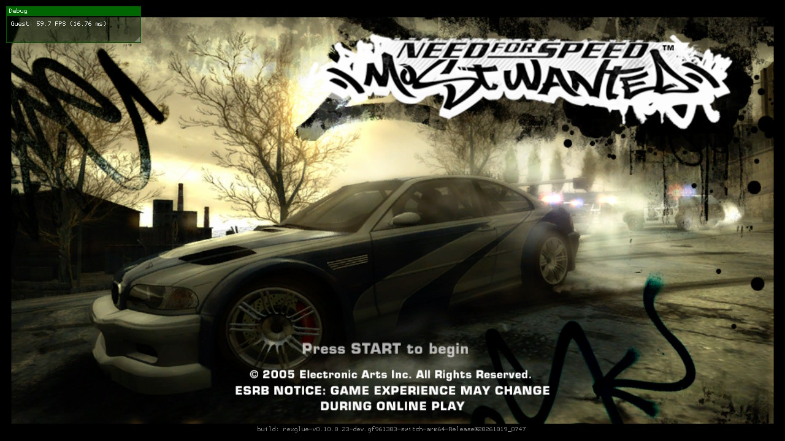

# xbox360-nx

Xbox 360 games running natively on the Nintendo Switch. It's not an emulator: each game's PowerPC code is
statically recompiled to C++ with [ReXGlue](https://github.com/rexglue/rexglue-sdk) and built for the Switch, and
frames are drawn by a native renderer.



> [!NOTE]
> You need your own copy of each game. This repository contains no game data or game code.

## Games

| Game | Folder | Status |
| --- | --- | --- |
| Need for Speed: Most Wanted (2005) | [`nfsmw_pal/`](nfsmw_pal) | Playable, about 30 FPS ([details](README.nfsmw.md)). PAL Spanish; other editions (USA, ...) are generated from it ([editions](docs/editions.md)) |
| Halo 3 | [`halo3/`](halo3) | In progress, not playable yet |

Every game is its own folder with its own NRO, and they all build on one shared SDK. A fix in `sdk/` reaches every
game. To add a game, see [porting another game](docs/porting-another-game.md).

## Run Need for Speed: Most Wanted

1. Get the NRO for your edition from [Releases](https://github.com/nx-mod/xbox360-nx/releases) (PAL Spain or USA:
   each `default.xex` needs its own build, see [editions](docs/editions.md)).
2. Make a folder on the SD card, for example `sdmc:/switch/nfsmw-nx/`, and put in it the NRO and the release's
   `nfsmw.toml`. Then the game, one of two ways:
   - **Disc image on the console:** put your `.iso` or `.xiso` (any name) in the folder; the first start copies it into
     `game_root/`. The image is one 7 GB file, so this needs an **exFAT** card (FAT32 cannot hold a file over 4 GB)
     and 7 GB more free. exFAT is more prone to corruption on the Switch than FAT32.
   - **Extracted on a PC** (works on FAT32, every file is under 1 GB):
     `python3 tools/fase1_extraer.py "your image.iso" -o game_root`, then copy the `game_root/` folder next to the NRO.
3. Build the shader library from the same image on a PC (Linux or WSL) and put `nfsmw_shaders_dk.nfsp` beside the
   NRO. It is made from your disc, so it is not shipped:
   ```sh
   INSTALADOR=path/to/nfsmw-nx-installer shaders/nfsmw_biblioteca_dk_linux.sh out/lib "your image.iso"
   ```
   It needs `node`, `g++`, `python3` and `spirv-val`, and a checkout of
   [nfsmw-nx-installer](https://github.com/StevensND/nfsmw-nx-installer) (see [shaders/README.md](shaders/README.md)).
4. Start the NRO from the homebrew menu in full-memory (title) mode. With an image, the first start copies it
   (several minutes); later starts skip that.

## What nx-mod changed

- One repository for several games on a shared SDK ([`rexglue-sdk-nx`](https://github.com/nx-mod/rexglue-sdk-nx)):
  NFS Most Wanted, and Halo 3 in progress.
- More editions from one code base: the PAL Spanish code is translated to the USA executable (`tools/editions/`).
- The game can be copied out of a disc image on the console at first start (PC extraction is optional).
- The deko3d shader library can be built on Linux and ARM64 with no native DXC (`shaders/nfsmw_biblioteca_dk_linux.sh`).
- A crash when a race starts is fixed (stray function splits in the code generation settings).
- Faster draw submission: inlined hashing in the geometry store and per-draw keys, and only the shader constants
  the game changed are compared.
- `nfsmw_intervalo_presentacion` (experimental): lifts the game's wait for a vblank before each frame, which rounds
  menus down to 30 FPS.
- Guest memory: read-only pages are mapped readable on the Switch (a storm of faults, and static in the audio).
- Diagnostics for the renderer, all off by default ([devlog](docs/deko3d-devlog.md)).

Open work is in [TODO.md](TODO.md).

## Layout

| Folder | Contents |
| --- | --- |
| `<game>/` | One per game: manifest, codegen fixes, hooks, renderer glue, CMake project |
| `sdk/` | **Submodule** → [`rexglue-sdk-nx`](https://github.com/nx-mod/rexglue-sdk-nx) (`switch` branch): the ReXGlue SDK + Horizon (Switch) layer + deko3d renderer, shared by every game |
| `shaders/` | Xenos shader translator and shader library tools |
| `tools/` | Codegen and build scripts |
| `docs/` | Documentation: start with [docs/README.md](docs/README.md) |

## Build

devkitA64 and libnx from [devkitPro](https://devkitpro.org), CMake, Ninja, Python, and your own copy of the game.
The steps are in [docs/building.md](docs/building.md).

## Credits

- **[StevensND](https://github.com/StevensND/nfsmw-nx)**: nfsmw-nx, the Switch port this repository is forked from:
  its Switch layer, renderer and documentation.
- **[madelrandel-blip](https://github.com/madelrandel-blip/NFSMW-Recompiled)**: NFSMW Recompiled.
- **[victorgbd](https://github.com/victorgbd/NFSMW-Recompiled-Mobile)**, **[codepdbh](https://github.com/codepdbh/nfsmw-android)**
  and **[frankyfife](https://github.com/frankyfife/NFSMW-Recompiled_ff)**: their forks' findings (online over a LAN
  server, frame pacing, on-device shader library) guide the [TODO](TODO.md).
- **[Tom Clay](https://github.com/rexglue/rexglue-sdk)**: the ReXGlue SDK, built on the work of the
  **[Xenia](https://xenia.jp)** team.
- ReXGlue forks whose codegen fixes are applied here, with credit in each commit:
  **[stuken](https://github.com/stuken/rexglue-sdk)** (D3D pack/unpack, vmsum, fctid/fres, FPSCR) and
  **[furqanagwan](https://github.com/furqanagwan/rexglue-sdk)** (stwcx. reservations, mffs, vsl).
- **[haloce-nx](https://github.com/nx-mod/haloce-nx)** (CC0): the first-launch copy of the game out of a disc image.
- **[summers-aaron](https://github.com/summers-aaron/xenon-pc-comp)**: xenon-pc-comp, Halo 3 on ReXGlue for Linux.
  Used as a reference for what Halo 3 needs; none of its code is copied.
- **[hedge-dev](https://github.com/hedge-dev/XenosRecomp)**: XenosRecomp.
- **[danfromtico](https://github.com/danfromtico/mesa-switch)** and **[NaGaa95](https://github.com/NaGaa95/mesa-switch)**:
  mesa-switch.
- **[centollOS](https://github.com/centollOS/SwitchWakerHD)**: the uam shader compiler patches.
- **[devkitPro](https://devkitpro.org) and [switchbrew](https://github.com/switchbrew/libnx)**: devkitA64 and libnx.
- The other libraries listed in [THIRD_PARTY_NOTICES.md](THIRD_PARTY_NOTICES.md).

## Legal

Unofficial fan ports with no affiliation to Microsoft, Bungie, Electronic Arts or EA Black Box. "Halo" is a trademark
of Microsoft; "Need for Speed" is a trademark of Electronic Arts. You provide your own legally obtained copy of each
game. Running homebrew requires custom firmware, which violates Nintendo's terms and can get a console banned.

Source code is under the GPL-3.0 license (see [LICENSE](LICENSE)), inherited from nfsmw-nx. The SDK changes are under
the SDK's BSD-3-Clause license, and the shader translator and Mesa changes under MIT.
